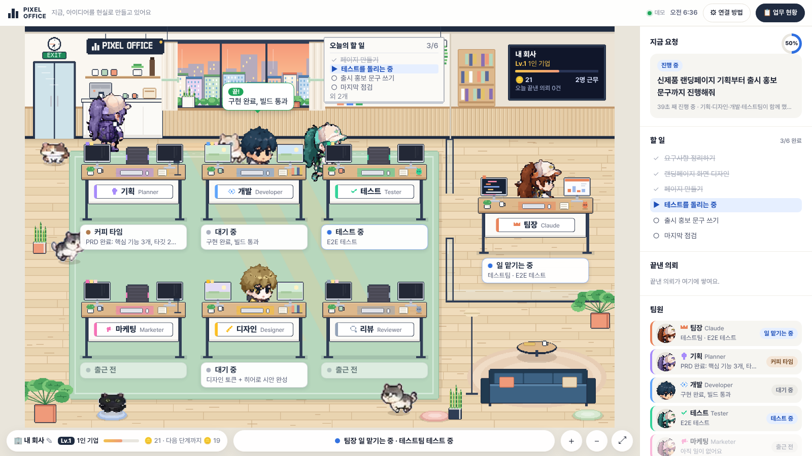

# 🏢 Pixel Office

**Claude Code 세션이 일하는 모습을 픽셀 오피스로 실시간 확인하세요.**

기획 · 개발 · 테스트 · 마케팅 · 디자인 · 리뷰, 여섯 명의 팀원(서브에이전트)에게 각자 책상이 있습니다. 팀장(Claude)이 일을 나눠 주면 팀원이 출근해서 자리에 앉아요. 지금 어떤 파일을 읽는지, 어떤 명령을 실행하는지 말풍선으로 보여 주고, 화이트보드에는 할 일 목록이 실시간으로 올라갑니다. 클라우드 세션(claude.ai/code)과 로컬 Claude Code 모두에서 동작합니다.

## ⚡ 가장 쉬운 방법: 내 PC에서 한 줄

[Node.js](https://nodejs.org)가 설치된 PC에서 터미널을 열고 아래 한 줄을 실행하세요. 서버도, 주소도, 가입도 필요 없습니다.

```bash
npx -y github:choolgeunpat/pixel-office
```

- 이 PC의 Claude Code(모든 프로젝트)에 hook과 팀원 6명이 연결되고, 브라우저에 사무실이 열립니다. 이후 평소처럼 Claude Code를 쓰면 됩니다.
- 지울 때는 `npx -y github:choolgeunpat/pixel-office uninstall` 을 실행하세요.

> 📖 코딩을 몰라도 따라 할 수 있는 **[사용 설명서(MANUAL.md)](MANUAL.md)** 가 있어요.
> 아래 "빠른 시작"은 **claude.ai 웹(클라우드) 세션**을 볼 때 필요한 서버 방식이에요.



## 이런 게 보여요

개발자가 아니어도 읽을 수 있게, 모든 문구는 쉬운 말로 바꿔서 보여 줘요. ("Edit src/auth.ts" 대신 "내용을 고치고 있어요 · auth.ts")

| 화면 | 의미 |
|---|---|
| 🪪 책상 아래 **상태 카드** | 지금 뭘 하는지 한눈에. 예: "자료 읽는 중 · PRD.md", "테스트 중", "대표님 확인 필요" |
| 💬 머리 위 말풍선 | 새 의뢰, 맡은 일, 끝낸 일, 문제처럼 **소식이 있을 때만** (동시에 3개까지) |
| 📋 화이트보드 · 오른쪽 **할 일** | 할 일 목록. 진행 중인 항목은 "~하는 중"으로 보여요 |
| 🧾 **오늘의 의뢰** | 내가 시킨 일(질문 포함)이 티켓으로 쌓여요: 진행 중 → 완료, 걸린 시간, 참여한 팀 |
| 📢 아래쪽 한 줄 | "지금" 누가 뭘 하는지 한 문장으로 |
| 🚪 문으로 걸어 들어와 자리에 앉음 | 팀장이 그 팀원에게 일을 맡김 (종이비행기가 날아가요) |
| ☕ 커피 머신으로 걸어감 | 잠깐 할 일이 없을 때: 커피 타임 → 오래 쉬면 졸다가 퇴근 |
| ✋ 노란 말풍선 + 알림 | Claude가 내 허락을 기다리는 중 |

### 사무실의 고양이들
- 고양이 5마리(모찌·까망·구름·크림·미미 — 보내 주신 "냥이 친구들" 시트 디자인 그대로)가 사무실에서 자기 일상을 살아요. 복도를 천천히 걷고, 앉아서 꼬리를 흔들고, 세수하고, 기지개를 켜고, 침대·소파·책상 밑에서 낮잠을 자고, 모니터 옆에 올라가요.
- 고양이는 **장식**이에요. 고양이가 하는 행동은 Claude의 작업 상태와 관계없어요. (실제 작업은 직원과 모니터 화면, 상태 카드로만 표시돼요.)
- 모니터는 실제 상태를 따라가요: 일하는 중에만 작업 화면이 나오고, 쉬는 중에는 배경화면, 끝나면 ✓, 문제가 생기면 !가 떠요.
- 움직임 줄이기 설정을 켜면 고양이는 제자리에서 쉬고, 직원도 걷지 않아요. 탭이 가려져 있으면 그림을 그리지 않아요.

### 회사를 운영하는 재미
- **매출(🪙)**: 의뢰를 끝내면 +10(질문은 +5), 팀원이 일을 끝내면 +5, 할 일을 체크하면 +2. 오를 때마다 코인이 떠오르고 꽃가루가 터져요.
- **회사 레벨**: 1인 기업 → 스타트업 → 성장 기업 → 중견 기업 → 대기업이 아닌 **유니콘**까지 6단계. 단계가 오를 때마다 **사무실이 바뀌어요**(트로피, 인증서 액자, 조명, 팀장실 카펫, 황금 유니콘 동상).
- **회사 이름**은 왼쪽 아래 ✎로 바꿀 수 있어요. 매출과 레벨은 이 브라우저에 저장돼요.
- 책상(또는 팀원 목록)을 **클릭하면 그 자리로 확대**되고, 휠·＋/－ 버튼·더블클릭으로도 확대·이동할 수 있어요.
- 코딩이 아닌 일(질문, 글쓰기, 조사)도 똑같이 보여요. 팀장이 직접 답하는 동안 "생각하는 중 → 조사하는 중 → 완료!"가 표시돼요.

## 동작 원리

```
Claude Code 세션 ──(hooks)──▶ Pixel Office 서버 ──(SSE)──▶ 브라우저의 픽셀 오피스
  .claude/hooks/pixel-office.sh      /api/r/<사무실키>/events      /r/<사무실키>
```

- Claude Code의 [hooks](https://code.claude.com/docs/en/hooks)가 이벤트(프롬프트, 도구 사용 전·후, 서브에이전트 시작·종료, 알림, 종료)마다 작은 스크립트를 실행하고, 스크립트가 이벤트를 서버로 보냅니다.
- 서브에이전트 안에서 발생한 이벤트에는 `agent_type`이 들어 있어서, 그 이름(planner, developer, Explore, `my-plugin:reviewer` …)을 보고 알맞은 책상을 고릅니다.
- 서버는 의존성이 없는 Node 서버(파일 2개)입니다. 사무실마다 최근 이벤트 3000개를 메모리에 보관합니다.

---

## 클라우드 세션용 빠른 시작 (서버 방식)

### 1. 서버 띄우기 (한 번만)

클라우드 세션은 인터넷 어딘가에 있는 서버로 이벤트를 보내야 합니다. 아래 중 하나를 고르세요.

**A. Render (무료, 클릭 몇 번)**

[](https://render.com/deploy?repo=https://github.com/choolgeunpat/pixel-office)

이 저장소를 fork했다면 위 링크의 `repo=` 부분을 내 fork 주소로 바꾸세요. 배포가 끝나면 `https://pixel-office-xxxx.onrender.com` 같은 주소가 생깁니다.
> 무료 플랜은 15분 동안 요청이 없으면 잠듭니다. 잠든 상태에서 들어온 첫 이벤트 몇 개는 깨어나는 동안 놓칠 수 있어요.

**B. Docker (내 서버 / Fly.io / Railway 등)**

```bash
docker build -t pixel-office .
docker run -d -p 8787:8787 -e DATA_DIR=/data -v pixel-office:/data pixel-office
```

**C. 내 컴퓨터 + 터널 (설치 없이 바로 체험)**

```bash
npm start
```

```bash
npx cloudflared tunnel --url http://localhost:8787
```

터널이 알려 주는 `https://….trycloudflare.com` 주소를 서버 주소로 쓰면 됩니다. 단, 이 주소는 터널을 다시 켤 때마다 바뀝니다.

### 2. 내 사무실 만들기

서버 주소를 열고 **내 사무실 만들기**를 누르면 `https://<서버>/r/<사무실키>` 형태의 개인 주소가 생깁니다. 사무실 키는 무작위 24자이고, 이 주소를 아는 사람만 사무실을 볼 수 있어요. **⚙ 연결 방법** 창에 내 주소가 이미 들어간 복사용 문장이 나옵니다.

### 3. 네트워크 허용 (클라우드, 처음 한 번만)

claude.ai/code → 세션 상단의 환경 이름 → **Edit** → **Network access**에서 Limited(또는 Custom)를 고르고, **Allowed domains**에 서버 도메인(예: `pixel-office-xxxx.onrender.com`)을 추가합니다. Full 접근이면 건너뛰어도 됩니다. ([문서](https://code.claude.com/docs/en/cloud-environments#network-access))

### 4. Claude에게 설치 시키기

보고 싶은 저장소로 세션을 열고 아래 문장을 그대로 보냅니다(연결 방법 창의 2번).

```
아래 명령을 이 저장소 루트에서 실행해서 Pixel Office를 설치해줘. 설치가 끝나면 바뀐 파일(.claude 폴더, CLAUDE.md)을 커밋하고 푸시해줘.

curl -fsSL https://<서버>/r/<사무실키>/install.sh | bash
```

`/r/<사무실키>/install.sh`는 사무실 주소가 미리 들어간 설치 스크립트입니다. 설치되는 파일은 다음과 같아요.

- `.claude/hooks/pixel-office.sh`: 이벤트를 서버로 보내는 스크립트
- `.claude/pixel-office.url`: 사무실 주소 (`PIXEL_OFFICE_URL` 환경 변수가 있으면 그쪽을 먼저 씀)
- `.claude/settings.json`: hook 11개 추가 (기존 설정과 다른 hook은 그대로 유지)
- `.claude/agents/{planner,developer,tester,marketer,designer,reviewer}.md`: 6명의 팀원
- `CLAUDE.md`: "팀원에게 나눠 맡기기" 안내 (`--no-team-guide`로 끌 수 있음)

옵션은 `bash -s -- <옵션>` 형태로 붙입니다.

| 옵션 | 설명 |
|---|---|
| `--no-save` | 주소 파일을 만들지 않음 (공개 저장소용: 대신 환경 변수 `PIXEL_OFFICE_URL` 설정) |
| `--url <주소>` | 일반 `/install.sh`에서 사무실 주소 지정 |
| `--no-agents` | 팀원 에이전트 추가 안 함 |
| `--force` | 같은 이름의 에이전트 파일 덮어쓰기 |
| `--uninstall` | 설치한 것 전부 제거 |

여러 번 실행해도 결과가 같습니다.

### 5. 새 세션 시작

hook은 세션이 시작될 때 불러오므로, 설치가 끝나면 **새 세션**을 열고 일을 시키세요. 팀원들이 출근합니다. 왼쪽 세션 목록에서 원하는 세션을 고를 수 있고, 클라우드 세션이면 **열기 ↗**로 claude.ai의 해당 세션으로 바로 이동합니다.

---

## 플러그인으로 설치하기 (로컬 Claude Code)

저장소 파일을 건드리지 않고 내 Claude Code에만 설치할 수도 있습니다.

```
/plugin marketplace add choolgeunpat/pixel-office
/plugin install pixel-office@pixel-office
```

플러그인에는 같은 hook과 6명의 팀원(`pixel-office:planner` …)이 들어 있습니다. 사무실 주소는 `PIXEL_OFFICE_URL` 환경 변수로 따로 설정해야 해요. 클라우드 세션에는 위의 `install.sh` 방식을 권장합니다.

## 팀 구성과 책상 배정

| 책상 | 기본 에이전트 | 이런 이름도 이 책상으로 |
|---|---|---|
| 기획 Planner | `planner` | plan, Plan, Explore, research, spec, architect |
| 개발 Developer | `developer` | dev, engineer, builder, general-purpose, frontend, backend |
| 테스트 Tester | `tester` | test, qa, debug, verify, validator |
| 마케팅 Marketer | `marketer` | marketing, copy, seo, content, writer |
| 디자인 Designer | `designer` | design, ui, ux, art |
| 리뷰 Reviewer | `reviewer` | review, security, audit |
| 팀장 Claude | (메인 대화) | 서브에이전트가 아닌 모든 활동 |

어느 키워드에도 맞지 않는 이름은 이름을 기준으로 여섯 책상 중 하나에 고정 배정됩니다. 배정 규칙은 [`public/lib/roles.js`](public/lib/roles.js)에 있어요. 캐릭터는 [pixel-distric](https://github.com/choolgeunpat/pixel-distric)의 남녀 캐릭터를 팔레트만 바꿔 사용합니다.

## 개인정보 · 보안

- **보내는 것:** 이벤트 종류, 도구 이름, 대상(파일 경로 뒤 두 단계, 명령 설명, 검색어), 프롬프트 앞부분, 할 일 목록, 서브에이전트 이름.
- **보내지 않는 것:** 파일 내용, 수정 내용(diff), 도구 실행 결과. hook 스크립트가 보내기 전에 지우고, 서버가 한 번 더 잘라 냅니다. 서버는 원본 페이로드를 저장하지 않습니다.
- **사무실 키:** 키가 곧 비밀번호입니다. 기본 설치는 키를 `.claude/pixel-office.url`에 저장하므로, 공개 저장소에서는 `--no-save`로 설치하고 환경 변수를 쓰세요.
- **내 서버 잠그기:** `PIXEL_OFFICE_ROOMS=키1,키2`를 설정하면 그 사무실만 이벤트를 받습니다.
- **Claude를 방해하지 않음:** hook은 비동기로 실행되고, 실패해도 항상 0으로 종료합니다. 서버가 꺼져 있어도 세션은 평소처럼 동작합니다.

## 서버 설정

| 환경 변수 | 기본값 | 설명 |
|---|---|---|
| `PORT` | `8787` | 포트 |
| `HOST` | `0.0.0.0` | 바인드 주소 |
| `DATA_DIR` | (없음) | 지정하면 사무실 기록을 `rooms.json`으로 저장 (1분마다, 그리고 종료할 때) |
| `PIXEL_OFFICE_ROOMS` | (없음) | 이벤트를 받을 사무실 키 목록 (쉼표로 구분) |

API: `POST /api/r/:key/events`(hook JSON 하나 또는 배열), `GET /api/r/:key/stream`(SSE), `GET /api/r/:key/events?since=`, `DELETE /api/r/:key`, `GET /healthz`.

## 개발

```bash
npm run dev
```

```bash
npm test
```

kit/를 고친 뒤에는 아래 명령으로 `kit/install.sh`와 `plugin/`을 다시 생성하세요. 생성 결과가 최신이 아니면 `npm test`가 실패합니다.

```bash
npm run build:kit
```

```
server/          Node 서버 (의존성 없음)
public/          웹 앱 (빌드 없음, ES modules)
  lib/           이벤트 정규화 · 역할 배정 · 오피스 상태 (서버와 공유)
  office/        픽셀 아트 씬, 캐릭터 스프라이트 런타임
kit/             hook 스크립트, 팀원 에이전트, 설치 스크립트 원본
plugin/          Claude Code 플러그인 (생성됨)
test/            node --test
```

데모(`/demo`)는 서버 없이 브라우저 안에서 실제 hook 형식의 이벤트를 만들어 보여 줍니다.

## 라이선스

MIT. 캐릭터 스프라이트는 [pixel-distric](https://github.com/choolgeunpat/pixel-distric)에서 가져왔고, 픽셀 폰트는 [Galmuri](https://github.com/quiple/galmuri)(SIL OFL 1.1)를 사용합니다.

---

### English (short)

Pixel Office streams a Claude Code session into a live pixel-art office: six subagent desks (planner, developer, tester, marketer, designer, reviewer) plus the lead.

1. Deploy the zero-dependency server (Render button, Docker, or `npm start` + a tunnel).
2. Open it and click "내 사무실 만들기" to get a private room URL.
3. Allow the server's domain in your cloud environment's network settings.
4. Ask Claude to run `curl -fsSL https://<server>/r/<room>/install.sh | bash` in the repo and push `.claude/` (the room URL is built into that script).
5. Start a new session and watch the team work.
